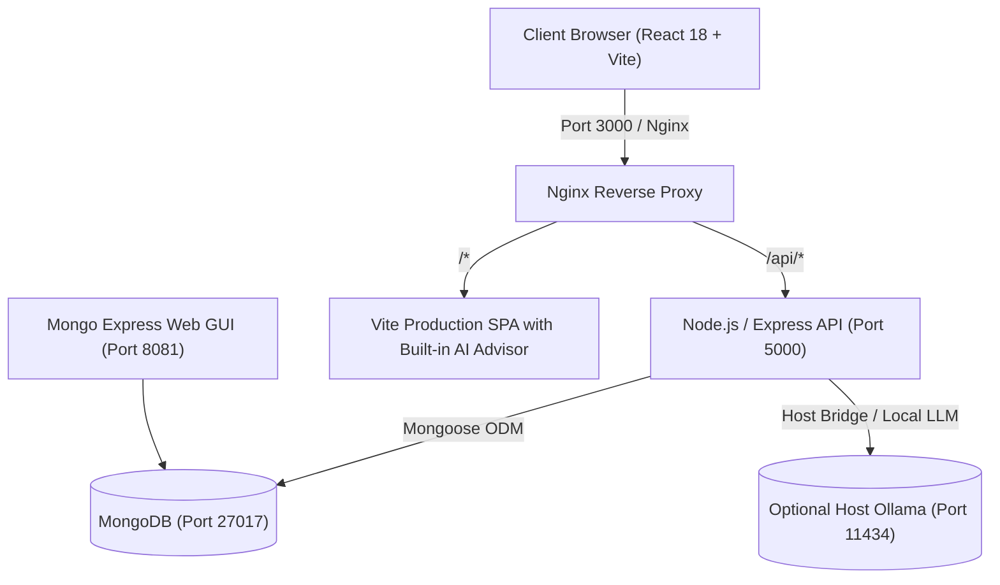

# 🏦 Apex Bank (ai-bank-app) — Modern MERN Digital Banking System


A full-stack, enterprise-grade Digital Banking Platform built with the **MERN** stack (MongoDB, Express.js, React, Node.js) and containerized with **Docker & Docker Compose**.

---

## ✨ Features

- **🔐 Secure Authentication & RBAC**:
  - JWT (JSON Web Tokens) with 30-day lifecycle.
  - Salted & hashed passwords with bcrypt (10 rounds).
  - Role-Based Access Control (`customer` and `admin`).
- **💳 Account & Card Management**:
  - Automatic generation of unique 10-digit bank account numbers upon registration.
  - Dynamic issuance of 16-digit virtual debit cards with CVV, expiry dates, and flip-to-reveal security.
  - Multi-account support per client (Checking, High-Yield Savings, Investment Vaults).
  - Account freezing and unfreezing capabilities.
- **⚡ Financial Operations & Ledger**:
  - **Instant Transfers**: Transfer funds to any account number with real-time recipient verification.
  - **Atomic Concurrency**: Transactions use atomic MongoDB conditional operations (`$gte`, `$inc`) to guarantee consistency and prevent double-spending or race conditions.
  - **Deposits & Cash Withdrawals**: Dedicated modals with preset amount quick-chips and projected balance simulation.
  - **Audit Ledger**: Comprehensive, searchable, and filterable transaction records with unique reference IDs (e.g. `TRF-481923-A9F2`) and modal receipt view.
- **📊 Real-Time Financial Analytics**:
  - Aggregated cashflow tracking (Inflow vs. Outflow breakdown).
  - Net period savings indicators.
  - Categorized expense allocation meters (Transfer, Shopping, Utilities, Salary, Investment).
- **👑 Administrator Central**:
  - Bank-wide capital liquidity & total holdings overview.
  - Total transaction volume & customer count metrics.
  - Client accounts management with one-click freeze/unfreeze controls.
  - System-wide immutable transaction ledger.
- **🤖 Ollama Local AI Financial Advisor**:
  - On-premise private AI advisor integrated into the banking dashboard.
  - Analyzes user balances, recent transaction context, and budget optimization questions.
  - Powered by local LLMs via containerized Ollama.
- **🐳 Dockerized Orchestration**:
  - Multi-container `docker-compose` setup for **MongoDB**, **Express API**, **React Client (Nginx)**, **Mongo-Express GUI**, and **Ollama Local LLM**.

---

## 🏛️ System Architecture



---

## 🚀 Quickstart with Docker Compose (Under 350 MB Total!)

Running the entire banking system requires only **one command**:

```bash
docker compose up --build
```

### Access URLs & Container Ports:
- **Banking Web App & AI Advisor**: [http://localhost:3000](http://localhost:3000)
- **REST API Backend**: [http://localhost:5001](http://localhost:5001) (mapped to 5001 to prevent Mac AirPlay 5000 conflict)
- **Ollama AI Engine Container**: [http://localhost:11434](http://localhost:11434)
- **Mongo-Express Database GUI**: [http://localhost:8081](http://localhost:8081)
- **API Health Check**: [http://localhost:5001/api/health](http://localhost:5001/api/health)

### 🤖 Lightweight Ollama AI Container (~70 MB):
- Containerized using minimal **`alpine/ollama`** (~70MB instead of official 2.85GB!).
- Automatically pulls tiny **`smollm:135m`** (~85MB) on start.
- Total AI footprint: **~155 MB** — completely within your 500 MB budget!


To run in detached background mode:

```bash
docker compose up -d
```

To stop containers:
```bash
docker compose down
```

---

## 💻 Manual Local Setup (Without Docker)

### 1. Prerequisites
- [Node.js](https://nodejs.org/) (v18+)
- [MongoDB](https://www.mongodb.com/) running locally on port 27017

### 2. Backend Setup
```bash
cd backend
npm install
npm run seed     # Populates demo users, accounts, and transactions
npm run dev      # Starts Express server on http://localhost:5000
```

### 3. Frontend Setup
```bash
cd frontend
npm install
npm run dev      # Starts Vite dev server on http://localhost:3000
```

---

## 🧪 Demo Credentials (Pre-seeded)

Use any of these demo accounts (with 1-click login on the sign-in page):

| Role | Name | Email | Password | Starting Balance |
| :--- | :--- | :--- | :--- | :--- |
| **Admin** | Bank Administrator | `admin@apexbank.com` | `password123` | System Oversight |
| **Customer** | Alice Johnson | `alice@example.com` | `password123` | Checking: $14,250.75 / Savings: $38,500.00 |
| **Customer** | Bob Martinez | `bob@example.com` | `password123` | Checking: $8,640.50 |
| **Customer** | Charlie Davis | `charlie@example.com` | `password123` | Checking: $5,120.00 |

### 🌱 Automatic DB Seeding & Visual Progress:
- **On Container Startup**: The backend automatically detects if the database is empty and runs the seed sequence with step-by-step progress logging in Docker console (`[🌱 DB Seed Progress: 0% -> 100%]`).
- **In the Web App**: Click the **"🌱 Seed / Reset User Database"** button on the Login page to re-seed demo accounts with a live animated progress bar right in the browser!
- **Via REST API**: `POST http://localhost:5001/api/auth/seed` triggers an immediate database reset and returns progress timestamps.


---

## 📖 REST API Specification

### Authentication (`/api/auth`)
| Method | Endpoint | Description | Auth Required |
| :--- | :--- | :--- | :--- |
| `POST` | `/api/auth/register` | Register customer & provision bank account | No |
| `POST` | `/api/auth/login` | Authenticate user & retrieve JWT token | No |
| `GET` | `/api/auth/profile` | Retrieve authenticated user profile | Bearer Token |

### Bank Accounts (`/api/accounts`)
| Method | Endpoint | Description | Auth Required |
| :--- | :--- | :--- | :--- |
| `GET` | `/api/accounts` | Get list of all accounts for current user | Bearer Token |
| `POST` | `/api/accounts` | Open a new account (Savings, Checking, Investment) | Bearer Token |
| `GET` | `/api/accounts/:id` | Get account details by ID | Bearer Token |
| `GET` | `/api/accounts/lookup/:accNo` | Verify and lookup recipient account number | Bearer Token |

### Financial Transactions (`/api/transactions`)
| Method | Endpoint | Description | Auth Required |
| :--- | :--- | :--- | :--- |
| `POST` | `/api/transactions/deposit` | Deposit funds into specified account | Bearer Token |
| `POST` | `/api/transactions/withdraw` | Withdraw cash from specified account | Bearer Token |
| `POST` | `/api/transactions/transfer` | Transfer funds to another account number | Bearer Token |
| `GET` | `/api/transactions/history` | Get filtered transaction ledger | Bearer Token |
| `GET` | `/api/transactions/analytics` | Get cashflow, inflow/outflow, and category stats | Bearer Token |

### Administration (`/api/admin`)
| Method | Endpoint | Description | Auth Required |
| :--- | :--- | :--- | :--- |
| `GET` | `/api/admin/metrics` | System holdings, transaction volume, and user counts | Bearer (Admin) |
| `GET` | `/api/admin/users` | List all users and their respective accounts | Bearer (Admin) |
| `PUT` | `/api/admin/accounts/:id/status` | Freeze or unfreeze a client account | Bearer (Admin) |
| `GET` | `/api/admin/transactions` | Global bank-wide transaction ledger | Bearer (Admin) |

---

## 🛡️ Security Implementation
- **Helmet HTTP Headers**: Protection against cross-site scripting, clickjacking, and MIME-sniffing.
- **Express Rate Limiting**: Throttles brute force requests (200 requests / 15 minutes).
- **Atomic Concurrency Protection**: Deductions and balance additions utilize atomic Mongoose query conditions to prevent overdrafts during simultaneous operations.
- **Password Protection**: Passwords are automatically hashed via bcrypt pre-save hooks and excluded from default queries (`select: false`).
